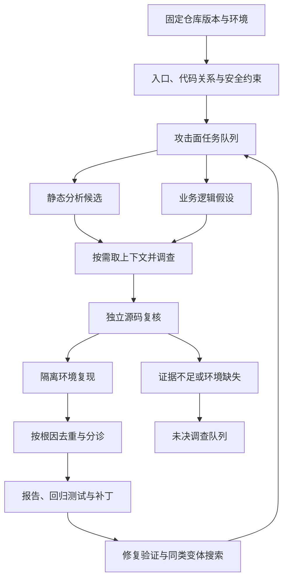

# 大型仓库安全与业务逻辑审计 Agent 调研

调研日期：2026-11-03。范围：源代码白盒审计，重点为安全漏洞、权限与租户隔离、跨模块业务逻辑。本文是对公开文档、开源设计及论文的案头调研，没有运行这些产品或复现其性能数据。产品公开架构不代表完整内部实现；论文与厂商实验的数值不能跨数据集直接排名。

## 1. 建议采用的方向

我建议采用“确定性编排 + 可检索的仓库事实 + 按攻击面划分的调查任务 + 独立验证”的架构。把业务安全约束作为一等数据，持续记录每个调查的证据、反证、未决假设及覆盖范围。

模型负责形成和检验漏洞假设；程序分析负责导航、候选生成和部分路径证据；隔离运行环境负责复现；调度器负责预算、去重、恢复和停止条件。这是本文综合建议，具体系统并不都采用所有组件。

优先借鉴：Anthropic 的审计生命周期、Semgrep 的候选与切片、Visa 的确定性阶段和证据模型、Antaeus 的业务逻辑推理、Shannon 的运行时验证。第一版应限制语言与框架，在一个真实服务上验证完整流程。

## 2. 别人是怎么设计的

### 2.1 Anthropic：Defending Code Reference Harness

官方参考实现把威胁建模、发现、验证、分诊和补丁拆开。它的大仓库实践包括组件摘要、风险排序、代码检索、按攻击面重新分区以及最后的系统级复查。项目明确标注不再维护，可用作设计样本。

值得细读的具体实现是 C/C++ 内存漏洞流水线：构建 ASAN 目标，recon 划分关注面，finder 生成触发输入；fresh container 中的 grader 接收 PoC 字节并独立复现，之后再做去重和报告。它适合借鉴证据传递与阶段隔离，业务 API 需要另做验证器。

来源：[仓库](https://github.com/anthropics/defending-code-reference-harness)、[大型仓库实践](https://github.com/anthropics/defending-code-reference-harness/blob/main/docs/best-practices.md)、[流水线](https://github.com/anthropics/defending-code-reference-harness/blob/main/docs/pipeline.md)。

### 2.2 Semgrep：静态分析引导 AI 调查

2026-05 的工程文章给出较清晰的路径：静态分析生成候选，构建包含相关函数、调用路径与数据流的程序切片，交给模型判断，再归一化、去重和过滤。增量分析根据控制流和数据流影响范围决定重查位置；组织背景通过 Memories 和文档补充。

2026-07-28 的 Agentic Workflows 将 Pro Engine、内部切片器 Mandoline 和模型组合起来，并提供 SDK 与编排设施。其名称中的 Multimodal 在这里指分析方法的组合。Pro 跨文件分析与内部切片器的能力，不能直接视为开源 Community Edition 已提供。

来源：[工程设计](https://semgrep.dev/blog/2026/operationalizing-ai-powered-detection/)、[Agentic Workflows](https://semgrep.dev/blog/2026/introducing-semgrep-agentic-workflows-automate-deep-vulnerability-hunting-at-scale/)。

### 2.3 Visa：Vulnerability Agentic Harness（VVAH）

公开框架将发现、修复、验证拆成 S0–S11；代码图每次扫描构建一次供分析阶段查询。部分阶段不调用模型，排序也由确定性逻辑完成。它支持将现有扫描器的发现注入验证流程，以统一结构输出 JSON、SARIF 和 Markdown；HTTP 场景可以补充运行时验证。

最值得借鉴的是工程边界：可重复工作由代码处理，判断交给模型，发现保留位置、前提和验证依据。源码对抗复核与可选 live confirmation 是不同证据层。

来源：[VVAH 仓库与 README](https://github.com/visa/visa-vulnerability-agentic-harness)。

### 2.4 Shannon：源码分析与运行中应用双路生成候选

当前公开架构有两条发现路径：运行时侦察与漏洞分析、agentic 源码分析；候选合并去重后交给 exploitation agents，只有实际演示成功的漏洞进入正式结果与 CI 门禁。它同时利用源码和真实请求响应。

适合借鉴白盒与动态证据汇合。对你要做的仓库审计，我建议另外保留“证据充分但环境暂不能复现”的待查状态，以便跟进跨服务、异步和并发问题；这是对该策略的调整建议。

来源：[Shannon，Architecture](https://github.com/KeygraphHQ/shannon#architecture)。

### 2.5 Strix：协作式动态安全测试

Strix 公开提供多 agent 协作，包含代理、浏览器、终端与 PoC 执行能力。它可以接收源码或应用目标，也支持 API 契约配合运行地址。README 描述了专项角色共享发现和组合漏洞的设计。

值得研究它的工具接口与测试环境。其公开功能清单不足以证明对任意百万行仓库的覆盖效果，需要用自己的仓库和预算评测。

来源：[Strix 仓库](https://github.com/usestrix/strix)。

### 2.6 Codex Security：持续扫描与多轮发现预算

当前 OpenAI 官方文档覆盖 Cloud、plugin、CLI 和 SDK。CLI 区分 standard 与 deep 模式；deep 暴露 worker 并发、最大调查轮数、时间上限及连续无新增时的停止条件，支持补充威胁模型和架构文档。

特别注意：独立的 `codex-security validate` 是只读源码复核，不构建目标、不执行应用、测试或 PoC。不能因命令叫 validate 就认定完成动态复现；各扫描模式有自己的验证流程。

来源：[概览](https://learn.chatgpt.com/docs/security)、[CLI reference](https://learn.chatgpt.com/docs/security/cli/reference)。

### 2.7 Trail of Bits：把审计经验拆成可组合能力

公开 skills 仓库包含上下文构建、差异审计、静态分析、误报复核、变体分析、属性测试以及补丁后验证等模块。值得学习的是将审计经验变成独立能力与交付规范，而不是寄希望于单条长提示词。这里仅调研其设计，没有安装或运行这些技能。

来源：[Trail of Bits skills](https://github.com/trailofbits/skills)。

### 2.8 Antaeus：针对仓库级逻辑漏洞

论文发表于 2026-07，9 月修订。流程是函数优先级排序、仓库上下文辅助推理、比较验证与结构化报告。围绕敏感操作推导安全条件，再检查是否满足；比较同类实现，过滤仅反映项目惯例的疑点。作者在 35 个含已确认逻辑漏洞的仓库上报告识别并解释了 20 个漏洞。

我认为这是业务逻辑方向最值得拆解的研究之一。但“多数实现一致”只能作为线索，不能作为安全证明；公共缺陷也可能遍布整个仓库。

来源：[Antaeus 论文](https://arxiv.org/abs/2607.01138)。

## 3. 近期新想法与能力边界

### 3.1 攻击面收缩也可以成为审计输出

Anthropic 在 2026-10-20 发布研究，关注默认暴露、配置组合以及认证或协议状态检查之前执行的敏感代码。这些问题不一定已经构成可利用漏洞，但可以指导减少暴露和增加适当门控。

建议单列 hardening 类结果，例如默认关闭敏感入口、限制解析发生的阶段。不要把所有加固建议都计入漏洞数量。

来源：[Attack surface reduction](https://www.anthropic.com/research/attack-surface-reduction)。

### 3.2 形式化验证开始进入更大规模实验

2026-10-22，Anthropic 与 Theorem 公布针对生产软件的证明实验。其明确限制包括单线程、静态 RISC-V/musl 模型、特定入口和性质；因此不能推广成完整真实部署的无漏洞保证。

建议先将形式化工具用于边界清晰的关键属性，例如权限谓词、金额守恒或单次消费状态，再由外部检查器验证。完整系统证明不宜作为 MVP 前置条件。

来源：[Formal verification](https://www.anthropic.com/research/formal-verification)。

### 3.3 大仓库定位本身仍然困难

Cisco 2026-09 发布的 VLoc Bench 用弱点描述与仓库访问评估漏洞文件定位，并同时测试修复前后快照。其初始实验最优 File F1 为 0.229。这说明“拿到相关函数后会分析”和“从大仓库找出相关函数”需要分别测量；该数字只适用于该测试协议。

来源：[Cisco 2026-10-06 说明](https://blogs.cisco.com/ai/foundation-ai-in-september-vloc-bench-and-cyber-capability-safety)。

### 3.4 要评测根因识别，而不只是文件命中

SecPRBench 2026-10-24 发布、10-30 修订，使用真实引入漏洞的代码变更评测。作者报告的 68% 漏检案例中，agent 已对含漏洞的文件发表评论，但讨论的是另一个机制。这提醒我们，代码导航之外还要测根因、前提及影响的正确性。

来源：[SecPRBench 论文](https://arxiv.org/abs/2610.33509)。

### 3.5 防御评测需要检查补丁是否保留功能

CWE-bench 2026-10-12 论文提出私有 audit-and-repair 评测：提供仓库与威胁模型，不提示具体弱点及位置；验证补丁阻断问题且保留原功能。可借鉴其任务定义，但其私有测试集无法直接作为公开本地基线。

来源：[CWE-bench 论文](https://arxiv.org/abs/2610.17020)。

## 4. 推荐架构：以下为综合设计建议



### 4.1 仓库事实与导航

- 固定 commit、构建参数、依赖与配置；源码结论必须能定位到该版本。
- 提取服务、API、RPC、事件消费者、定时任务与导入导出入口。仅靠目录树无法表示异步业务链。
- 建立定义、引用、调用、路由、认证中间件、数据库实体与资源归属的可查询关系。第一版可以是关系表与索引，不要求图数据库。
- 每条关系记录来源与可信程度：语法解析、静态推断、运行时观测，或模型假设。动态派发、反射、依赖注入未解析时保留 unknown，不能当作不可达。
- 组件摘要负责导航，最终判断回到源码与运行证据。摘要与缓存绑定内容哈希、模型和规则版本。

工具应至少支持文本/结构搜索、符号定义与引用、调用方/被调用方、路由到处理器、历史差异和测试执行。向量检索可辅助寻找概念或文档，涉及执行路径和权限时优先查询明确关系。

### 4.2 独立保存业务安全约束

业务漏洞的判定需要“应当怎样”的依据。为每个约束保存来源、适用范围、状态和冲突，而不是把现有代码行为自动视为需求。

| 约束类型 | 示例 | 主要证据来源 |
| --- | --- | --- |
| 资源归属 | 普通用户只能读取所属租户的订单 | 权限设计、数据模型、接口契约 |
| 角色能力 | 审批权限不能由提交者通过请求字段赋予 | 权限矩阵、业务规范 |
| 金额守恒 | 累计退款不得超过已支付额 | 产品规则、财务规则、测试 |
| 状态转换 | 未支付订单不能直接发货 | 状态机、业务文档 |
| 幂等 | 同一支付回调不能重复入账 | 协议、幂等记录、事务实现 |
| 生命周期 | 撤权后异步任务不能继续使用旧授权 | 授权语义、队列与缓存设计 |

区分“文档声明”“维护者确认”“根据实现推断”。推断约束可以驱动搜索，成立与否仍需要核实。跨层冲突应作为结果：例如接口文档要求租户隔离，但仓储层查询缺少该限制。

### 4.3 任务按攻击面与业务链划分

任务示例：订单创建到支付回调；退款与对账；文件上传到异步解析；租户切换与缓存；邀请与角色变更。

每个任务定义入口集合、预期安全约束、允许追踪的依赖、预算和已有结论。agent 可以跨文件寻找路径。专项分析按需启用，如注入、认证授权、并发状态、配置组合；无需一开始建立十几个固定角色。

最后安排一次系统级调查，检查分区之间的身份、数据和状态假设是否一致。PR 审计使用变更点及其影响范围，并结合周期性基线扫描。

### 4.4 发现与验证分离

发现阶段鼓励产生有证据的候选；验证器使用独立上下文，针对上游校验、授权、类型约束、不可达路径和部署前提寻找反证。不要仅让原 agent 重读自己的报告后给出置信度。

建议使用分离的字段，而不是单一 verified 布尔值：

| 字段 | 示例值 |
| --- | --- |
| 源码证据 | supported / contradicted / insufficient |
| 运行时复现 | reproduced / not_reproduced / not_attempted / environment_blocked |
| 威胁模型范围 | in_scope / out_of_scope / unknown |
| 分诊状态 | candidate / accepted / rejected / duplicate |

这样可以表达“源码支持，但测试环境缺队列服务”或“成功触发，但需要超出威胁模型的管理员能力”。未能复现并不能自动证明不存在漏洞。

验证越权应比较不同用户和租户；验证业务漏洞应检查动作序列、重放、失败重试与并发，而不只测试一次 HTTP 请求。测试环境应保留有意义的授权与外部依赖语义，mock 不能直接取消待测安全控制。

### 4.5 Finding 是证据对象

建议结构至少包含：

```text
finding_id / repository / commit
root_cause / violated_invariant / invariant_source
entry_point / attacker_identity / attacker_control
path_evidence / relevant_checks / counterevidence
configuration_and_preconditions / impact
source_assessment / runtime_assessment / scope_assessment
reproduction_artifacts / environment_fingerprint
related_findings / proposed_test / proposed_fix
```

位置用稳定符号与代码指纹辅助定位。不同端点可能共享同一根因，去重时同时保留影响面；同一文件的独立缺陷也不能因距离近而强行合并。报告应明确哪些路径被观察、哪些仅被推断。

### 4.6 编排、成本与恢复

使用可持久化状态机编排阶段，各阶段内部允许 agent 自主调查。保存任务、候选、工具输出、测试结果、成本和终止原因。

- 原始候选与被排除候选均保留，方便回放与误报分析。
- 对相同版本、上下文与分析配置复用缓存；共享授权器或安全配置变化时使相关结论失效。
- 调度优先级结合外部可达性、资产影响、近期变更、历史漏洞和未覆盖面。
- 通过每个已确认根因的成本、复现率与人工处理时间分配预算。
- 连续无新增可作为预算停止条件，不能写成“审计通过”或“证明安全”。

### 4.7 运行边界

审计目标仓库、构建脚本、依赖和 PoC 都可能执行不可信内容。发现与复现环境应使用隔离工作区，准备阶段安装依赖后固定快照；复现阶段只开放目标测试环境和必要模型接口。宿主凭据与生产数据不应进入环境。仓库文本不能修改调度器的规则、预算或验证门槛。

## 5. 值得尝试的差异化能力

以下是基于前述资料提出的实验方向，需要用实际数据验证：

1. **业务约束图**：把主体、角色、资源、操作、状态与校验关联，找入口间或阶段间的检查缺口。
2. **同类实现比较**：同资源的 list/get/update/export、REST/GraphQL、单条/批量路径对比权限与租户过滤；差异只产生候选，回到规范验证。
3. **序列测试生成**：为支付、退款、审批、邀请等流程生成非法跳转、重放与并发序列，并用业务属性作 oracle。
4. **历史修复驱动变体搜索**：用历史真实缺陷总结缺失检查和修复模式，在全仓库查同类；将有效结论沉淀成规则与回归测试。
5. **配置组合审计**：查两个独立合理的开关是否组合后导致 fail-open，维护可追踪的组合测试。
6. **调查缺口清单**：agent 结束时输出尚未查明的调用方、身份传递、异步消费者和部署条件，供下一轮定向补证。
7. **补丁交叉验证**：一个补丁若消除多个 PoC，提示可能共享根因；若仍有同类 PoC 成立，提示修复不完整。正常功能测试同时保留。

## 6. MVP 与评测计划

建议第一版选一种主要语言及 Web 框架，聚焦 BOLA/IDOR、租户隔离、敏感字段 mass assignment 三类问题。选有历史真实漏洞和可运行测试的服务，同时纳入已修复快照、合法授权行为作为负例。

依次完成：仓库与入口索引 → 约束草稿及来源 → 分区调查 → 独立源码复核 → 少量关键 API 的隔离复现 → JSON/Markdown 报告 → 可恢复任务队列。

比较三组基线：普通 coding agent + 搜索工具；静态扫描器；完整混合流水线。在相同模型、预算与目标版本下，逐项关闭威胁模型、关系索引、分区、独立验证和动态复现，观察各自增益。

必须分开测量：

- 盲审发现召回：不给漏洞名、文件位置或修复说明。
- 定位质量：是否找到正确代码、调用路径与业务约束。
- 根因准确率：不是仅提到同文件或相近 CWE。
- 输出精确率：人工确认的有效根因占比。
- 运行时复现率与环境可执行率：分开统计，避免把构建失败误当检测失败。
- 修复效果：旧版本触发、补丁阻断、正常功能保持，同类变体是否消除。
- 成本、耗时、重复率、人工分诊时间，以及预算用尽时的未覆盖面。

盲审测试需要隐藏未来补丁与漏洞描述，防止历史信息泄漏。SEC-bench Pro 更偏已给披露信息后的 PoC 复现，不可把其结果当成完全盲审的发现能力；VLoc Bench、SecPRBench 和自建业务约束用例分别补充不同环节。

来源：[SEC-bench Pro](https://arxiv.org/abs/2605.26548)、[VLoc Bench 说明](https://blogs.cisco.com/ai/foundation-ai-in-september-vloc-bench-and-cyber-capability-safety)、[SecPRBench](https://arxiv.org/abs/2610.33509)。

## 7. 优先阅读顺序

1. [Anthropic 官方工程文章](https://claude.com/resources/articles/using-llms-to-secure-source-code)：理解完整审计生命周期。
2. [Semgrep 大仓库工程设计](https://semgrep.dev/blog/2026/operationalizing-ai-powered-detection/)：理解候选、切片、增量分析。
3. [Visa VVAH](https://github.com/visa/visa-vulnerability-agentic-harness)：看可落地的阶段划分与证据交付。
4. [Antaeus](https://arxiv.org/abs/2607.01138)：研究业务逻辑安全条件与比较验证。
5. [Shannon 架构](https://github.com/KeygraphHQ/shannon#architecture)：看源码和运行时调查的汇合。

适合当前目标的产品定位：能在给定预算下，持续寻找违反明确安全与业务约束的跨模块路径，并提交可复核证据的仓库审计系统。
